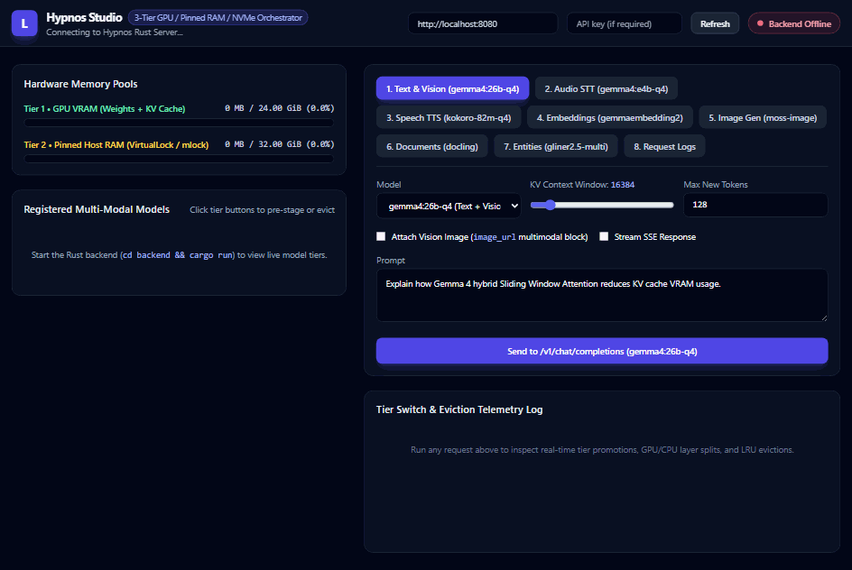
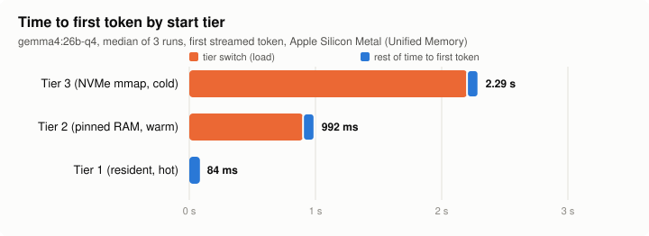

<p align="center">
  
</p>

<h1 align="center">Hypnos</h1>

<p align="center">
  <b>One OpenAI-compatible endpoint for every modality on one GPU,<br>
  with a scheduler that decides what lives in VRAM so you don't have to.</b>
</p>

Hypnos serves chat, vision, speech-to-text, text-to-speech, embeddings and image generation from a
single Rust process. llama.cpp, stable-diffusion.cpp and ONNX Runtime are linked in, so there is no
Python, no sidecar and no second server competing for the same GPU. A lease-based scheduler moves
models between GPU memory, pinned RAM and NVMe on demand: the models you use all the time stay hot,
the big ones come in when asked for, and nothing is evicted while a request is using it.

- **One process, one port, one memory budget.** Every engine books its weights, KV cache and scratch
  space with the same planner, which checks its bookings against the GPU's real free memory after
  every load.
- **Three memory tiers.** Tier 1 is GPU VRAM (on Apple Silicon, Metal's share of unified memory),
  Tier 2 is page-locked host RAM that promotes over PCIe without touching the disk, and Tier 3 is the
  memory-mapped model file on NVMe.
- **Priorities, not timeouts.** `realtime_pinned` models never leave the GPU, `high` ones are kept
  warm in RAM, `low` ones are evicted first. Models that don't fully fit run with part of their
  layers on the GPU (CUDA).
- **Drop-in for OpenAI clients.** `/v1/chat/completions` (streaming, images, audio), `/v1/embeddings`,
  `/v1/audio/transcriptions`, `/v1/audio/speech` (streaming), `/v1/images/generations`, with
  optional API keys and in-process HTTPS. Plus `/v1/documents/convert` (PDFs, images and office
  documents to Markdown with docling, page by page) and `/v1/entities` (zero-shot named-entity
  extraction with GLiNER2.5, labels chosen per request).
- **Observable.** A live playground shows each model's tier as requests come in, every response
  carries its placement and timing, `/metrics` is Prometheus, and a request log keeps recent calls.
- **Runs on CUDA (Windows, Linux) and Apple Silicon (Metal).**

<p align="center">
  
</p>

<p align="center"><sub>The playground on an Apple M5 Max limited to a simulated 32 GB machine
(<code>simulate_physical_memory_bytes</code>), real time: chat, image, speech, chat. The 26B model and
MOSS-Image don't fit together, so each request evicts the other; Kokoro and the embedder stay pinned.</sub></p>

### Measured

Measured on one 24 GB CUDA GPU with the default lineup (full reports in [docs/bench/](docs/bench/)):

| Scenario | Result |
| :--- | :--- |
| Chat decode, Gemma 4 26B-A4B Q4 | ~100 tokens/s per stream |
| Five-turn chat, time to first token per turn | 300 ms → **145 ms** with KV prefix reuse |
| Follow-up question about the same image | 300 ms → **105 ms** (image not re-encoded) |
| Four concurrent chat clients | **2.18x** the aggregate decode throughput of one (continuous batching) |
| Text-to-speech, time to first audio | 5.4 s → **385 ms** with streaming synthesis |

Model swap: time to the first token of Gemma 4 26B-A4B Q4 (15.8 GB) depending on where the
scheduler finds it, measured on an Apple M5 Max (128 GB, Metal) with the OS page cache dropped for
the Tier 3 runs ([report](docs/bench/swap-metal-2026-10-29.md)):



<!-- PERF-5: add the CUDA run (bench.sh --scenarios 7) next to the Metal one. -->

### How it compares

| | Hypnos | Ollama | LocalAI | llama-swap |
| :--- | :--- | :--- | :--- | :--- |
| Shape | one process, engines linked in | one server, a runner process per loaded model | API gateway over separate backend processes | proxy that starts and stops one server per model |
| Focus | every modality on one GPU at once | LLMs, easy model library | broadest set of backends and model formats | swapping any OpenAI-compatible server |
| Deciding what is loaded | shared memory planner, priorities, leases, warm RAM tier | load on request, unload after an idle timeout | per backend | one model (or group) at a time |

Pick Ollama if you want the easiest install and a curated model library, LocalAI if you need a
backend Hypnos doesn't have, and vLLM or SGLang for multi-user datacenter throughput. Hypnos is for
the case where one machine has to serve a whole multi-modal stack (a voice assistant, an agent with
speech, images and retrieval) and VRAM is the bottleneck.

---

## Quickstart

### Prebuilt binaries

Each [GitHub release](https://github.com/advancedlogic/hypnos/releases) has archives for Linux x64
(CUDA), Windows x64 (CUDA) and macOS arm64 (Metal), with the playground, the example config and a
model downloader included. Unpack one and run everything from that folder:

```bash
./scripts/fetch-models.sh     # the default lineup, ~31 GB into models/ (or one model id)
./hypnos                      # reads hypnos.toml; API and playground on http://127.0.0.1:8080
```

On Windows: `powershell -ExecutionPolicy Bypass -File scripts\fetch-models.ps1`, then `.\hypnos.exe`.

| Archive | Needs |
| :--- | :--- |
| `linux-x64-cuda` | glibc 2.39+ (Ubuntu 24.04+), NVIDIA driver 570+, CUDA 12 runtime libraries (`libcudart.so.12`, `libcublas.so.12`, `libcublasLt.so.12`) and `libgomp1` |
| `windows-x64-cuda` | NVIDIA driver 570+, the release's `windows-x64-cuda12-runtime.zip` unpacked beside `hypnos.exe` (or the CUDA Toolkit 12.x), the MSVC 2015–2022 redistributable |
| `macos-arm64-metal` | Apple Silicon, macOS 14+; run `xattr -dr com.apple.quarantine .` once in the folder (the binaries are not notarized) |

The binaries link espeak-ng statically, so the archives are distributed under the GNU GPL v3 or
later (see [License](#license)); each one includes the license texts and links its source tag.

### Docker (CUDA)

Linux with an NVIDIA GPU and the [NVIDIA Container Toolkit](https://docs.nvidia.com/datacenter/cloud-native/container-toolkit/latest/install-guide.html):

```bash
mkdir -p models
docker run --rm -v ./models:/opt/hypnos/models --entrypoint ./scripts/fetch-models.sh \
  ghcr.io/advancedlogic/hypnos                       # ~31 GB, or append one model id
docker run --gpus all -p 8080:8080 -v ./models:/opt/hypnos/models ghcr.io/advancedlogic/hypnos
```

The playground and API are then on http://127.0.0.1:8080. The image's config is the CUDA example
(`/opt/hypnos/hypnos.toml`, listening on all interfaces inside the container); mount your own over
it, or mount one elsewhere and set `-e HYPNOS_CONFIG=/path/in/container.toml`. Set
`-e HYPNOS_API_KEYS=...` before publishing the port beyond localhost. Build it yourself with
`docker build -t hypnos .`; `--build-arg JOBS=N` sets the compile parallelism (default 2, which
fits 16 GB of RAM: some CUDA kernels need several GB each). The image is
GPL-3.0-or-later as a whole, like the archives; the license texts are in `/opt/hypnos`.

### From source

The first build compiles every native engine and takes 10–20 minutes.

**You need:** Rust 1.92+ through rustup, CMake 3.2x+, Ninja, Node.js (for the playground), and
either the CUDA toolkit with an NVIDIA GPU (Windows needs MSVC 2022; see
[Building from source](#building-from-source)) or an Apple Silicon Mac with the Xcode command line
tools.

```bash
git clone https://github.com/advancedlogic/hypnos.git && cd hypnos
./backend/scripts/setup-build-env.sh   # once per machine: GPU arch, toolchain pins
./backend/scripts/vendor.sh            # fetch the pinned engine sources into backend/vendor/
./run.sh models                        # the default lineup, ~31 GB into backend/models/
./run.sh build                         # backend + playground (Metal is picked automatically on Apple Silicon)
./run.sh start                         # API on http://localhost:8080, playground on http://localhost:5173
```

On Windows use `powershell -ExecutionPolicy Bypass -File backend\scripts\setup-build-env.ps1` and
`run.bat` with the same arguments; `vendor.sh` runs under Git Bash.

Startup refuses to run when a configured model's files are missing, so the default profile needs the
whole lineup. To try Hypnos with a single model, use a config of your own instead (next section).
On a Mac, [macOS (Apple Silicon)](#macos-apple-silicon) lists which models fit at once for each RAM
size.

Then send a request with any OpenAI client, or curl:

```bash
curl http://localhost:8080/v1/chat/completions \
  -H "Content-Type: application/json" \
  -d '{"model": "gemma4:e4b-q4", "messages": [{"role": "user", "content": "Hello!"}]}'
```

```python
from openai import OpenAI
client = OpenAI(base_url="http://localhost:8080/v1", api_key="unused")
print(client.chat.completions.create(
    model="gemma4:e4b-q4",
    messages=[{"role": "user", "content": "Hello!"}],
).choices[0].message.content)
```

`./backend/scripts/smoke_test.sh` sends one real request per modality to a running server.

---

## Bring your own models

Any GGUF that llama.cpp loads works for chat and embeddings; the chat template is read from the
file. A complete config with a single model looks like this (paths are relative to `backend/`):

```toml
# backend/my.toml
[[models]]
id = "qwen3:8b"                      # the "model" name clients send
modality = "text_generation"         # or "embeddings"; add additional_modalities = ["vision"] with an mmproj
engine = "ggml_llama"
weights_path = "models/Qwen3-8B-Q4_K_M.gguf"
# aux_weights_path = "models/mmproj-....gguf"   # vision / audio projector, if the model has one
priority = "high"                    # realtime_pinned | high | normal | low
initial_tier = "tier2_pinned_ram"    # stage in RAM at startup; default tier3_nvme_ssd loads on first use

[models.arch]                        # optional; sizes the KV cache and the GPU/CPU layer split
default_context_len = 8192           # context reserved per load (layers, KV heads, head_dim,
                                     # max context and sliding window are read from the GGUF)
kv_dtype = "q8_0"                    # f16 | q8_0 | q4_0
```

```bash
HYPNOS_CONFIG=my.toml ./run.sh start backend     # or: cd backend && ./target/release/hypnos my.toml
```

On Windows: `set HYPNOS_CONFIG=my.toml` and then `run.bat start backend`.

- `[models.arch]` fields you leave out are read from the GGUF header at startup
  (`<arch>.block_count`, `.attention.head_count_kv`, `.attention.key_length`, `.context_length`,
  `.attention.sliding_window[_pattern]`) and logged; values you set always win, and a mismatch with
  the file is logged too. Per-layer values (Gemma 4) are booked at their largest, so the plan errs
  on the safe side.
- Weight size is read from the file. `[server]`, `[limits]` and `[hardware]` are optional; GPU
  memory is detected, so you only set budgets to stay below what the device has.
- Speech, text-to-speech and image generation need the engine-specific fields shown in
  [backend/hypnos.example.toml](backend/hypnos.example.toml), which documents every option.
  Startup validates the config and prints one error per problem.

---

## Default model lineup

Every engine runs **inside the `hypnos` process**: llama.cpp + libmtmd, stable-diffusion.cpp,
ONNX Runtime + espeak-ng, docling.rs and GLiNER2.5 are compiled and linked natively (CUDA or Metal). No Ollama,
LM Studio or Python sidecar is involved.

| Model ID | Modalities Served | Engine | Files (under `backend/models/`) | Default Tier Policy |
| :--- | :--- | :--- | :--- | :--- |
| **`gemma4:26b-q4`** | **Text Generation + Vision** (`/v1/chat/completions`) | `ggml_llama` | `gemma-4-26B-A4B-it-Q4_0.gguf` (13.6 GiB) + `mmproj-gemma-4-26B-A4B-it-BF16.gguf` (1.1 GiB) | `High` (Tier 2 Pinned RAM ↔ Tier 1 VRAM, hybrid 5:1 SWA KV cache) |
| **`gemma4:e4b-q4`** | **Audio / STT + Chat** (`/v1/audio/transcriptions`) | `ggml_llama` | `gemma-4-E4B-it-Q4_0.gguf` (4.3 GiB) + `mmproj-gemma-4-E4B-it-BF16.gguf` (0.9 GiB) | `High` (Tier 2 Pinned RAM ↔ Tier 1 VRAM) |
| **`kokoro-82m-q4`** | **Text-to-Speech** (`/v1/audio/speech`) | `onnx_runtime` | `kokoro/model_fp16.onnx` (155 MiB) + `kokoro/voices/*.bin` | `RealtimePinned` (always resident; runs on CPU) |
| **`gemmaembedding2`** | **Vector Embeddings** (`/v1/embeddings`) | `ggml_llama` | `embeddinggemma-2-Q8_0.gguf` (295 MiB) | `RealtimePinned` (always hot in Tier 1 VRAM) |
| **`moss-image`** | **Image Generation** (`/v1/images/generations`) | `ggml_diffusion` | `MOSS-Image-SFT-Q4_K.gguf` (3.3 GiB) + `Qwen3.5-9B-Q4_K_M.gguf` (5.7 GiB) + `flux2-vae.safetensors` + `moss_tokenizer.json` | `Low` (promoted to Tier 1 VRAM on demand, evicts idle models) |
| **`docling`** | **Document Conversion** (`/v1/documents/convert`) | `docling` | `docling/` (310 MiB: layout, TableFormer, OCR) | `Normal`, `device = "cpu"` (loaded on demand into host RAM in ~0.3 s, ~1.8 GiB booked, no VRAM) |
| **`gliner2.5-multi`** | **Entity Extraction** (`/v1/entities`) | `gliner` | `gliner2.5-multi/` (1.15 GiB: encoder, boundary heads, tokenizer) | `Normal`, `device = "cpu"` (loaded on demand in under a second, ~3.2 GiB booked, no VRAM) |

### Model files

`./run.sh models` (Linux / macOS) or `run.bat models` (Windows) downloads everything below into
`backend/models/` with `curl`, about 33 GB. Files already present are skipped, an interrupted download
resumes on the next run, and `./run.sh models moss-image` fetches a single model. The file list lives
in [backend/models.manifest](backend/models.manifest); on Apple Silicon it picks the fp32 Kokoro graph.

Download sources (public Hugging Face repositories, and one GitHub release):

| File | Source |
| :--- | :--- |
| `gemma-4-26B-A4B-it-Q4_0.gguf`, `mmproj-gemma-4-26B-A4B-it-BF16.gguf` | `ggml-org/gemma-4-26B-A4B-it-GGUF` |
| `gemma-4-E4B-it-Q4_0.gguf`, `mmproj-gemma-4-E4B-it-BF16.gguf` | `ggml-org/gemma-4-E4B-it-GGUF` |
| `embeddinggemma-2-Q8_0.gguf` | `ggml-org/embeddinggemma-2-GGUF` |
| `kokoro/model_fp16.onnx` (macOS: `kokoro/model.onnx`), `kokoro/voices/*.bin` | `onnx-community/Kokoro-82M-v1.0-ONNX` (`onnx/` and `voices/` folders) |
| `MOSS-Image-SFT-Q4_K.gguf` | `leejet/MOSS-Image-SFT-GGUF` |
| `Qwen3.5-9B-Q4_K_M.gguf` | `unsloth/Qwen3.5-9B-GGUF` |
| `flux2-vae.safetensors` | `Comfy-Org/MOSS-Image` (`vae/`) |
| `moss_tokenizer.json` | `OpenMOSS-Team/MOSS-Image-Base` (`tokenizer/tokenizer.json`) |
| `docling/` (`layout_heron_int8.onnx`, `tableformer/`, `ocr_*`) | `docling-project/docling.rs` GitHub release `models-v1` |
| `gliner2.5-multi/` | `jugaadsrl/gliner2.5-multi-v1-onnx` (`fp32_25/` folder) |

Notes:
- Kokoro's quantized exports (`model_q8f16.onnx`, `model_q4.onnx`) crash the statically linked
  ONNX Runtime CPU provider at session creation on Windows; use the fp16 graph.
- On Apple Silicon use the fp32 graph (`onnx/model.onnx`): the fp16 one overflows to a silent
  (all-NaN) waveform for some voice/text pairs there. Hypnos now rejects such output with an error.
- `kv_dtype = "q8_0"` and the sliding-window KV cache keep the Gemma 4 context budgets small; all
  budgets live in `backend/hypnos.example.toml`.

---

## Building from source

### Prerequisites

- Rust **1.92+** (rustup stable). `backend/.cargo/config.toml` pins the rustup toolchain's `rustc`
  because a standalone Rust install may shadow it on PATH.
- CMake 3.2x+ and **Ninja**, plus MSVC on Windows. With **CUDA 13.0** the host compiler must be an
  MSVC **14.4x** toolset (VS 2022); the `.cargo/config.toml` pins it via `CUDAHOSTCXX`.
- CUDA toolkit; `CUDAARCHS` in `.cargo/config.toml` selects the GPU architecture (default `120`,
  RTX 50 series).
- `backend/vendor/` holds the engine bindings with upstream llama.cpp **b11982** (EmbeddingGemma 2
  support) and stable-diffusion.cpp **master-1024** (MOSS-Image support); sd.cpp is built as a shared
  library (`stable-diffusion.dll`) so its ggml does not collide with llama.cpp's.
- First build compiles all engines (10–20 minutes). `backend/scripts/smoke_test.sh` exercises every
  endpoint against a running server.

### macOS (Apple Silicon)

M1 or later, macOS 14+. llama.cpp and stable-diffusion.cpp run on the GPU through Metal; there is
no CUDA and no Python involved. Design notes and open items: [docs/apple-silicon.md](docs/apple-silicon.md).

```bash
xcode-select --install          # clang, Metal compiler, frameworks
brew install cmake ninja
./backend/scripts/vendor.sh
./run.sh models                 # ~31 GB of model files into backend/models/
./run.sh build backend          # = cargo build --release -p hypnos-server --no-default-features --features metal
./run.sh start backend          # uses backend/hypnos.macos.example.toml
```

- A plain `cargo build` selects the default `cuda` feature and fails on a Mac; always pass
  `--no-default-features --features metal` (`run.sh` does this on Darwin/arm64).
- CPU and GPU share one pool of RAM. Tier 1 is the Metal working set (about 2/3 to 3/4 of RAM),
  Tier 2 is limited to what Tier 1 leaves free, and models are placed fully on the GPU or not at
  all. `sudo sysctl iogpu.wired_limit_mb=<MiB>` raises the GPU ceiling until the next reboot.
- What fits at once: 16 GB, `gemma4:e4b-q4` plus the small models; 32 GB, one of `gemma4:26b-q4`
  or `moss-image` plus the small models; 48 GB, both Gemma 4 models; 64 GB and up, the whole lineup.
- For manual debugging, use `brew install llama.cpp` instead of the Windows binaries in `backend/tools/`.

### First-time build setup

The native engines need machine-specific settings (GPU architecture, CUDA host compiler, rustc pin).
Generate them once; the result lands in the git-ignored `<repo>/.cargo/config.toml`:

```powershell
# Windows
powershell -ExecutionPolicy Bypass -File backend\scripts\setup-build-env.ps1
```
```bash
# Linux / macOS
./backend/scripts/setup-build-env.sh
```

`backend/vendor/` (engine sources, git-ignored) is recreated from pinned commits plus patches with
`./backend/scripts/vendor.sh`, whose header lists the pins; the patches are in
[backend/vendor/patches/](backend/vendor/patches/). CPU-only builds (no CUDA toolkit, e.g. CI) use
`cargo build --workspace --no-default-features`.

---

## Running

### Run scripts

`run.bat` (Windows) and `run.sh` (Linux / macOS / Git Bash) are small process managers. Building
and starting are separate steps: `build` compiles, `start` launches the compiled binary and never
invokes cargo.

```text
run.bat [build|start|stop|restart|status]      [backend|frontend|all]
./run.sh [build|start|stop|restart|status|logs] [backend|frontend|all]
```

| Command                     | Effect                                                        |
|-----------------------------|---------------------------------------------------------------|
| `... build`                 | `cargo build --release --bin hypnos` + `npm install` (first run compiles the native engines) |
| `... build backend`         | compile only the Rust server to `backend/target/release/hypnos[.exe]` |
| `run.bat` / `./run.sh`      | start backend (port 8080) and frontend (port 5173) from the built artifacts |
| `... start backend`         | start only the Rust server binary; fails with a hint if it is not built yet |
| `... restart frontend`      | stop + start only the Vite dev server                         |
| `... stop`                  | stop both (kills the whole process tree, frees the ports)     |
| `... status`                | show what is running, on which PID, and whether the backend is built |
| `./run.sh logs [target]`    | follow `.run/backend.log` / `.run/frontend.log`               |
| `... models [model id]`     | download the model files into `backend/models/` (all, or one model) |

`restart` does not rebuild: run `build` after changing Rust code, then `restart backend`.
`HYPNOS_PROFILE=debug` makes `build`/`start` use the dev profile (`backend/target/debug/`) instead.

On Windows each service gets its own console window; on Linux/macOS they run detached with logs
under `.run/`. Both scripts prefer the rustup toolchain in `~/.cargo/bin` (the native engines need
rustc 1.92 or newer).

### Manual launch

#### 1. Start the Rust Backend (`http://localhost:8080`)
```bash
cd backend
cargo test
cargo run --bin hypnos -- hypnos.example.toml
```

#### 2. Start the Svelte 5 Playground (`http://localhost:5173`)
```bash
cd frontend
npm install
npm run dev
```

---

## Limiting memory and simulating smaller machines

All in `[hardware]` (bytes; 0 = off / auto):

| Setting | Effect |
| :--- | :--- |
| `vram_budget_bytes` | Cap on Tier 1 (GPU memory). Clamped to what the device reports, so it can only lower the budget. |
| `pinned_ram_budget_bytes` | Cap on Tier 2 (warm host RAM). Clamped to physical RAM minus a 4 GiB reserve. |
| `simulate_physical_memory_bytes` | Behave like a machine with this much RAM (never more than installed): Tier 1 and Tier 2 are derived as there. On a Mac this includes Metal's GPU share, estimated at 2/3 of RAM up to 36 GB and 3/4 above. |
| `max_process_memory_bytes` | Soft cap on memory the `hypnos` process holds, measured from the OS before every model load. Idle models are evicted to stay under it; if that is not enough the request fails with HTTP 507 (`process_memory_cap`). |

The budgets steer the scheduler, they are not OS-enforced: memory an engine allocates beyond its
estimate is caught only by `max_process_memory_bytes`, and only at the next load. On macOS the process
figure is the `phys_footprint` plus the model weights llama.cpp maps into Metal (file-backed, so the
footprint leaves them out); on Linux the resident set; on Windows the working set. GPU memory on a
discrete card is limited by `vram_budget_bytes` only. `/v1/memory/status` reports
`process_memory_bytes` next to the budgets, and `recent_evictions` lists the scheduler's last automatic
evictions with their reason (`memory_budget`, `full_gpu_placement`, `process_memory_cap`). The
playground's memory panel shows the process bar, a "Simulated" tag and those evictions. Disk space is only consumed by `models` downloads, which
check free space first.

---

## Operating the server

| Endpoint | Purpose |
| :--- | :--- |
| `GET /health` | liveness: version and uptime |
| `GET /ready` | readiness: 503 until startup tier initialization has finished |
| `GET /metrics` | Prometheus text: per-route counters and latency, scheduler promotions/evictions/load failures/rejections, VRAM bookkeeping vs. real device memory, per-model tier and leases, and per-model execution histograms (`hypnos_chat_ttft_ms`, `hypnos_chat_queue_ms`, `hypnos_chat_context_ms`, `hypnos_chat_prefill_tokens_per_s`, `hypnos_chat_decode_tokens_per_s`, `hypnos_tts_rtf`, `hypnos_tts_ttfa_ms`, `hypnos_stt_rtf`, `hypnos_image_jct_s`; each also exposes a `_last` gauge) and prefix-cache counters (`hypnos_prefix_cache_hits_total`, `_misses_total`, `_tokens_reused_total`) |
| `GET /v1/memory/status` | full 3-tier snapshot, including `tier1_vram_real_free_bytes` and `tier1_vram_unaccounted_bytes` |
| `POST /v1/memory/tier` | manual promote / demote (`{"model": "...", "target_tier": "tier2_pinned_ram"}`); refused with 429 while the model is leased |
| `GET /v1/logs` | recent API calls, newest first (`?model=&route=&status=ok|error|4xx|5xx&limit=`): route, status, duration, model, tokens in / out / cached, tokens/s, tier switch; `GET /v1/logs/{id}` adds the prompt and completion text (level `debug`) and the request / response payloads with media replaced by placeholders (level `trace`) |
| `POST /v1/logs/level` | `{"level": "off|error|warn|info|debug|trace"}` changes what is captured at runtime (`server.request_log_level` sets the start value, `server.request_log_capacity` the ring size); `DELETE /v1/logs` empties the ring. The playground's "Request Logs" tab is a client of these |

Behaviour that matters in production:

- **Startup validation**: missing weight files, duplicate ids, impossible budgets or engine
  combinations abort startup with one error per problem; warnings are logged.
- **Real VRAM reconciliation**: after every load/unload the planner compares its bookings with the
  device's free memory (ggml backend API) and never hands out more than the device really has.
- **Admission and limits** (`[limits]` in `hypnos.toml`): per-model queue bound (HTTP 429 when
  exceeded), request timeout (HTTP 504), body/audio/image/prompt size limits, `max_tokens` cap.
- **Cancellation**: when a client disconnects, the generation is stopped at the next token
  (llama.cpp), chunk (Kokoro) or diffusion step (sd.cpp) and the lease is released.
- **Persistent contexts, slots and prefix reuse** (llama.cpp models): a resident model is served
  by one worker thread that keeps a single `llama_context` for the whole residency and runs
  requests through execution slots (`slots` per model, default 1; the planner books KV for every
  slot). Requests in different slots are decoded together, one `llama_batch` per step, so several
  chats share each forward pass; `hypnos_telemetry.engine.concurrent_slots` reports how many
  shared a request's steps. With `prefix_cache = true` (default) a
  prompt that extends what a slot processed last prefills only the new part, and an image or audio
  clip already in the cache is not re-encoded; `usage.prompt_tokens_details.cached_tokens` reports
  the reused positions. Idle slot caches are cleared after `server.kv_idle_timeout_secs`.
- **Exposure**: binds `127.0.0.1` by default; CORS allows loopback origins only unless
  `server.allowed_origins` says otherwise. To serve beyond the local machine, set both:
  - `server.api_keys` (or env `HYPNOS_API_KEYS`, comma-separated, which replaces the list): every
    `/v1/*` route then needs `Authorization: Bearer <key>`, as OpenAI clients send it. A missing or
    wrong key gets HTTP 401 in the OpenAI error shape (`code: invalid_api_key`); rejections are
    logged with route and reason, never the key. Keys are held only as SHA-256 digests and compared
    in constant time. `/health` and `/ready` stay open for probes; `/metrics` too unless
    `server.metrics_require_auth = true`.
  - `[server.tls]` with `cert_path` / `key_path` (PEM) to serve HTTPS in-process (rustls); plain
    HTTP when absent. A bad certificate stops startup before any model loads.

  Startup warns when a non-loopback `host` has no keys, or keys but no TLS. The playground has an
  API-key field next to the backend URL; the key is stored in that browser only.
- **Logs**: `server.log_format = "json"` (or env `HYPNOS_LOG_FORMAT=json`) for log shippers; every
  response carries an `x-request-id` header.
- **Shutdown**: Ctrl+C / SIGTERM finishes in-flight requests, then releases every engine.
- **Tests**: `cargo test --workspace` runs engine-free scheduler tests (mock backend: promotion,
  eviction order, rollback on load failure, admission, cancellation, shutdown) plus unit tests;
  `cargo test -- --ignored` runs the GPU lifecycle test against the real weights;
  `backend/scripts/smoke_test.sh` exercises every endpoint of a running server. CI
  (`.github/workflows/ci.yml`) runs fmt + clippy, CPU (Linux, Windows) and Metal (macOS) builds
  and tests, and the frontend build on every push and pull request.
- **Telemetry**: every response's `hypnos_telemetry` carries the tier placement plus an `engine`
  object with the request's timing split (`queue_ms`, `context_ms`, `prefill_ms`, `decode_ms`,
  `ttft_ms`, `prefill_tokens_per_s`, `decode_tokens_per_s`; `audio_secs` and `rtf` for speech).
  `/v1/audio/speech` reports the same in `x-hypnos-inference-ms`, `x-hypnos-audio-secs` and
  `x-hypnos-rtf` headers.
- **Streaming speech**: `POST /v1/audio/speech` with `"stream": true` returns audio as it is
  synthesized, chunk by chunk: raw 16-bit little-endian PCM at 24 kHz for `response_format: "pcm"`,
  or a WAV whose header declares an open-ended length (players read to end of stream) for `wav`.
  The first chunk is cut at the first clause boundary so playback starts after one short synthesis;
  `hypnos_tts_ttfa_ms` on `/metrics` tracks the time to first audio.
- **Document conversion** (Hypnos extension): `POST /v1/documents/convert` takes a multipart
  upload (`file`) or a JSON body (`file` as base64 or a data URI, or `url`) and returns
  `{"object": "document", "pages": [...], "markdown": "...", "usage": {...}}`. Options: `pages`
  (`"3"`, `"2-5"`), `ocr` (default true: pages without a text layer are read with OCR),
  `output_format` (`json` adds each page's docling document), `stream` (one server-sent event per
  page, then the joined document) and `describe_pictures` (a vision model such as `gemma4:e4b-q4`
  writes a description under every picture). PDFs are converted one page at a time through models
  that stay loaded (about 0.1 s a page on an M5 Max CPU; the first table loads TableFormer), so
  memory is the same for 5 pages or 500; the joined Markdown puts back tables, numbered lists and
  sentences that a page break cut. Images, DOCX, PPTX, XLSX, HTML and Markdown work too.
  `limits.max_document_bytes` (100 MiB) caps the input. `device = "gpu"` runs docling on CoreML
  (Metal builds) or CUDA (built with `--features docling-cuda`, not part of the release archives:
  the prebuilt ONNX Runtime GPU build needs CUDA 13 and cuDNN 9) and needs the fp32 models
  (`./run.sh models docling-gpu`). On Apple Silicon the CPU is faster and lighter; CoreML only
  frees the CPU cores.
- **Entity extraction** (Hypnos extension): `POST /v1/entities` with `{"model", "input": text or
  [texts], "labels": ["person", "medication", ...], "threshold": 0.5, "flat": true}` returns one
  entity list per text (`text`, `label`, character `start` / `end`, `score`). The labels are free
  text: GLiNER2.5 is zero-shot and multilingual. More than 8 labels run as separate passes so they
  do not compete for the same spans, and texts longer than 512 words are read in overlapping
  windows (1,700 words with 11 labels: 1.5 s on an M5 Max CPU).
- **Benchmark**: `backend/scripts/bench.sh [--host URL] [--out docs/bench/<name>.md]` runs the
  fixed execution scenarios from `docs/execution-efficiency-plan.md` (cold chat, five-turn chat,
  vision chat, concurrent clients, TTS, voice round trip) against a running server and prints a
  Markdown report; the current baseline is `docs/bench/baseline-2026-10-29.md`. Scenario 7
  (`--scenarios 7 [--chart out.svg]`, not in the default set) stages a model in Tier 3, 2 and 1
  with `POST /v1/memory/tier` and times the first request from each; before the Tier 3 runs it
  evicts the weight files (`--swap-files`) from the OS page cache on Linux and macOS.

---

## Repository Structure

```text
hypnos/
├── backend/                     # Rust Workspace (Axum OpenAI Server + 3-Tier Memory Scheduler)
│   ├── Cargo.toml
│   ├── hypnos.example.toml
│   └── crates/
│       ├── hypnos-core/         # Config, KV-Cache + Gemma 4 SWA Estimator, OpenAI Schemas
│       ├── hypnos-memory/       # CUDA / ROCm / Metal UMA Topology & OS Pinned RAM Manager
│       ├── hypnos-scheduler/    # Lease-based Admission Control, Partial Offload & Eviction
│       ├── hypnos-backends/     # Native llama.cpp+mtmd, stable-diffusion.cpp, ONNX Runtime, docling & GLiNER engines
│       └── hypnos-server/       # Axum HTTP/SSE OpenAI Server & Multi-Modal Lifecycle Tests
└── frontend/                    # Svelte 5 (Runes) + Tailwind CSS Interactive Playground
    ├── package.json
    ├── vite.config.js
    └── src/
        └── App.svelte           # Live 3-Tier Visualizer + Modality Playground tabs
```

---

## License

Hypnos's source code is licensed under either of [Apache License, Version 2.0](LICENSE-APACHE) or
[MIT license](LICENSE-MIT), at your option. Unless you explicitly state otherwise, any contribution
you intentionally submit for inclusion in this work, as defined in the Apache-2.0 license, is dual
licensed as above, without any additional terms or conditions.

A `hypnos` binary built with the default engines statically links espeak-ng (GPL-3.0-or-later) for
text-to-speech and is therefore distributed under the GPL v3 or later as a whole. Model weights are
downloaded separately and are covered by their own licenses. See
[THIRD-PARTY-NOTICES.md](THIRD-PARTY-NOTICES.md) for every engine and its license; the GPL text is
[licenses/GPL-3.0.txt](licenses/GPL-3.0.txt).
