# Hypnos Desktop: user manual

Hypnos Desktop is a chat app for your own AI models. You talk to a chat model as you would to
any assistant, and it can hand work to the other models on the same computer: it makes and
edits images, reads documents and web pages, listens to your voice and answers aloud, and finds
names, places and dates in a text. Everything runs on your machine, or on a Hypnos server you
choose; nothing goes to a cloud service.

This manual covers version 0.7. The screenshots show a Mac with the default lineup of models.

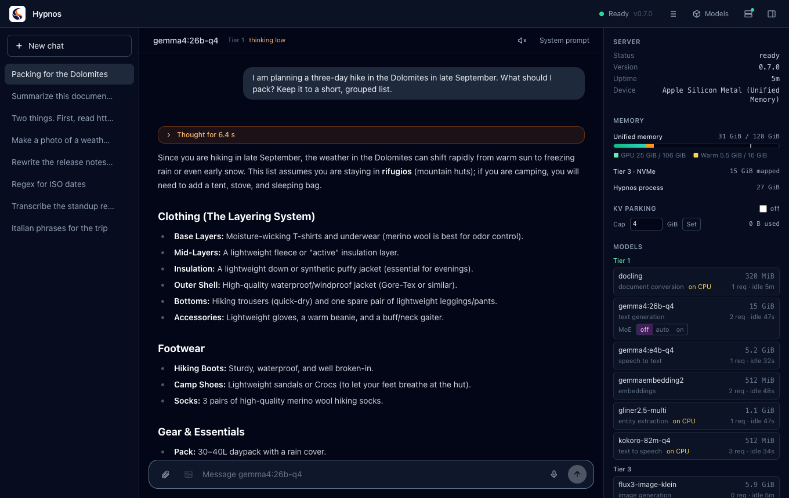

## Contents

1. [Installing](#1-installing)
2. [The first start](#2-the-first-start)
3. [A tour of the window](#3-a-tour-of-the-window)
4. [Chatting](#4-chatting)
5. [Thinking](#5-thinking)
6. [Files, links and attachments](#6-files-links-and-attachments)
7. [Voice: speaking and listening](#7-voice-speaking-and-listening)
8. [Images](#8-images)
9. [Tools: the chat model's helpers](#9-tools-the-chat-models-helpers)
10. [Choosing models](#10-choosing-models)
11. [Settings](#11-settings)
12. [The local server](#12-the-local-server)
13. [The server panel](#13-the-server-panel)
14. [The request log](#14-the-request-log)
15. [The menu bar and notifications](#15-the-menu-bar-and-notifications)
16. [Keyboard shortcuts](#16-keyboard-shortcuts)
17. [Troubleshooting](#17-troubleshooting)
18. [Where your data is kept](#18-where-your-data-is-kept)

## 1. Installing

Download the installer for your system from the
[GitHub releases](https://github.com/advancedlogic/hypnos/releases):

| System | File | Server |
| :--- | :--- | :--- |
| macOS (Apple Silicon) | `hypnos-desktop-<version>-macos-arm64.dmg` | included: the app starts it for you |
| Windows | `-windows-x64.msi` or `-windows-x64.setup.exe` | not included |
| Linux | `-linux-x64.deb` or `-linux-x64.AppImage` | not included |

On a Mac, open the `.dmg` and drag Hypnos to Applications. The app carries its own server, so
there is nothing else to install.

On Windows and Linux the app needs a Hypnos server to talk to: one you run on the same computer
(the server release archive, or the Docker image) or one on another machine. Section 12 shows
how the app can start a server installed on this computer.

The release notes say whether the installers are signed. If they are not:

- **macOS** refuses the first open. Open System Settings > Privacy & Security and click
  **Open Anyway** next to the message about Hypnos.
- **Windows** shows "Windows protected your PC". Click **More info**, then **Run anyway**.

## 2. The first start

### On a Mac: the guided setup

The first time you open the app it has no models yet, so it opens the **guided setup**. It
recommends models that fit your computer and downloads them for you.

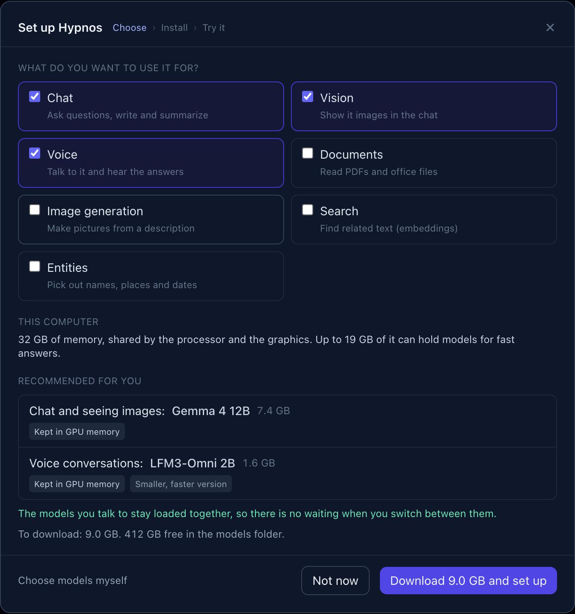

1. **Tick what you want Hypnos for**: Chat, Vision (showing it images), Voice (talking to it
   and hearing the answers), Documents, Image generation, Search and Entities. Chat, Vision and
   Voice are ticked to start with. Each extra use can add a model and a download.
2. **Read the recommendation.** "This computer" says how much memory the Mac has and how much of
   it can hold models. "Recommended for you" lists each model with what it does for you, its
   download size, and a note on how it runs:
   - *Kept in GPU memory*: always loaded, so it answers at once.
   - *Loads when needed*: loaded from disk the first time you use it (a few seconds).
   - *Runs on the processor*: small helpers that need no graphics memory.
   - *Partly in GPU memory: slower*: it fits only in part; answers come more slowly.
   - *Smaller, faster version*: a lighter variant chosen so everything fits.

   The green line under the list says whether the models you talk to stay loaded together, so
   that switching between them is instant.
3. **Click "Download … and set up".** The app downloads the files (you can stop and resume),
   sets up the server with the new models and restarts it.
4. **Try it.** Once the server is ready, the setup runs a short check with your new models: a
   chat answer, the Hypnos logo described by the vision model, and a spoken sentence heard back
   by the speech-to-text model. Each step shows how long it took.

"Choose models myself" opens the Models dialog instead (section 10). "Not now" closes the setup;
open it again later from **Models > Guided setup…**.

### On Windows and Linux, or with another server

Click the status in the top right (it says *Unreachable* until a server answers) to open the
**Connection** settings, enter the server's address (for example `http://localhost:9999`, or
`http://192.168.1.20:9999` for another computer) and, if the server asks for one, its API key.
Click **Test connection**, then **Save**. See section 11.

### The status

The status in the header tells you where the server is:

| Status | Meaning |
| :--- | :--- |
| **Connecting** | the app is reaching the server |
| **Warming up** | the server is up and still loading its first models; chats wait until it is ready |
| **Ready** (green) | everything works; the server's version is shown next to it |
| **Unreachable** (red) | no server answers at that address |
| **API key refused** (red) | the server asks for a key and yours is missing or wrong |

The app keeps trying on its own: when the server comes back, the status turns green again.

## 3. A tour of the window

- **Header** (top): the Hypnos logo; on the right, the **status** (click it for the Connection
  settings), the **request log** button (☰), **Models**, the **local server** button (a green
  dot when the app's server runs) and the button that shows or hides the **server panel**.
- **Sidebar** (left): **New chat** and your chats, newest first. Click one to open it; hover
  it and click × to delete it.
- **Chat** (middle): the conversation. Its header shows the chat model and where it is loaded
  (Tier 1 is the graphics memory, section 13), "thinking low/medium/high" when thinking is on,
  the speaker button and **System prompt**. At the bottom is the composer, where you type.
- **Server panel** (right): what the server is doing: memory, the models and where each one
  is, and the cost of the last answer (section 13). Hide it with the panel button or Cmd/Ctrl+.

## 4. Chatting

Type in the composer and press **Enter** to send; **Shift+Enter** starts a new line. The answer
streams in as the model writes it. Click **Stop** (the square that replaces the send arrow) to
cut it short.

Under each answer you find:

- a line with the answer's speed: tokens per second, the time to the first word, the number
  of tokens, and where the model was loaded from when it had to load first (for example
  "loaded from Tier 2 in 1.0 s");
- **Copy** (the answer as text), **Read aloud** and **Log** (this answer's record in the
  request log, section 14);
- the **regenerate** arrow, which asks the same question again. Under one of your earlier
  messages it asks that one again and removes what came after it; the app asks before it
  removes anything.

Every chat answers with the **default chat model**. Change it in Models with "Make default
for… → Chat" (section 10); the chat header shows which one it is.

**System prompt** (top right of the chat) gives the model standing instructions for this chat
only, such as "Answer in Italian" or "You are a careful copy editor". A dot after the button
means the chat has one.

Chats are saved on this computer as you go (section 18). **New chat** (Cmd/Ctrl+N) starts an
empty one.

## 5. Thinking

Some models can **think** before they answer: they reason step by step first, which helps with
plans, comparisons, maths and tricky questions, and costs some time. The models that can do it
show a **Thinking** menu on their row in Models (section 10): Off, Low, Medium or High. Each
model keeps its own level, and the chat header shows "thinking low" (or medium, high) while it
is on.

While the model thinks, its thoughts stream into an **orange panel** above the answer
("Thinking…"). When the answer starts, the panel folds to "Thought for N s"; click it to read
the thoughts again.

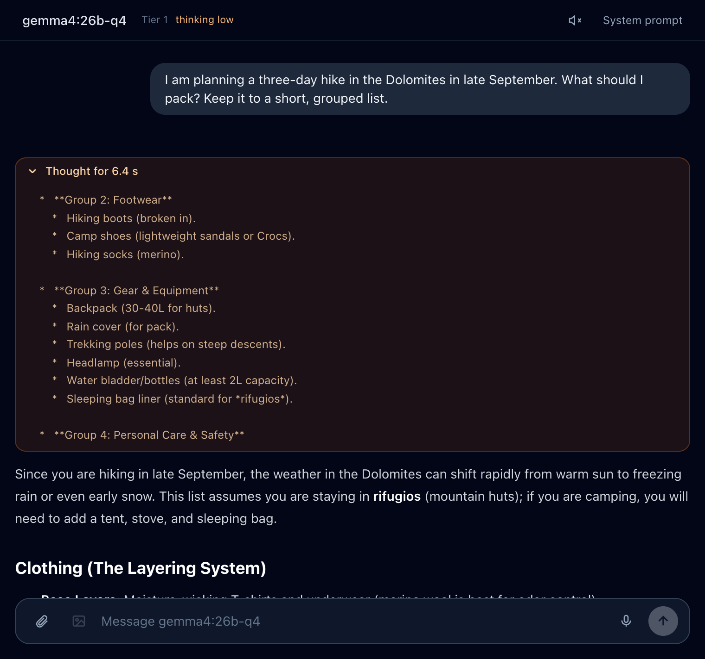

The thoughts are kept with the chat but never sent back to the model. Low, Medium and High give
it about 500, 2,000 and 6,000 words' worth of thinking (tokens) before it must answer.

## 6. Files, links and attachments

Add files with the **paperclip**, by dragging them onto the chat, or by pasting. Each file
shows as a chip above the composer while the app prepares it; click a chip to see what was
read from it.

| File | What the model gets |
| :--- | :--- |
| Images (PNG, JPEG, WebP, GIF, BMP, TIFF) | the picture, scaled to 1024 pixels. If the chat model cannot see, a model that can answers instead, and the answer says so |
| PDF, Word, PowerPoint, Excel, HTML | the text as Markdown, with tables, converted by the document model |
| Text and code files | the text as it is |
| Audio (WAV, MP3, M4A, FLAC, Ogg) | a transcript, made by the speech-to-text model |
| Video (MP4, MOV, MKV, WebM) | six frames from the video plus a transcript of its sound |

Documents and text are cut at about 60,000 characters (the chip says so). Attachments are saved
with the chat.

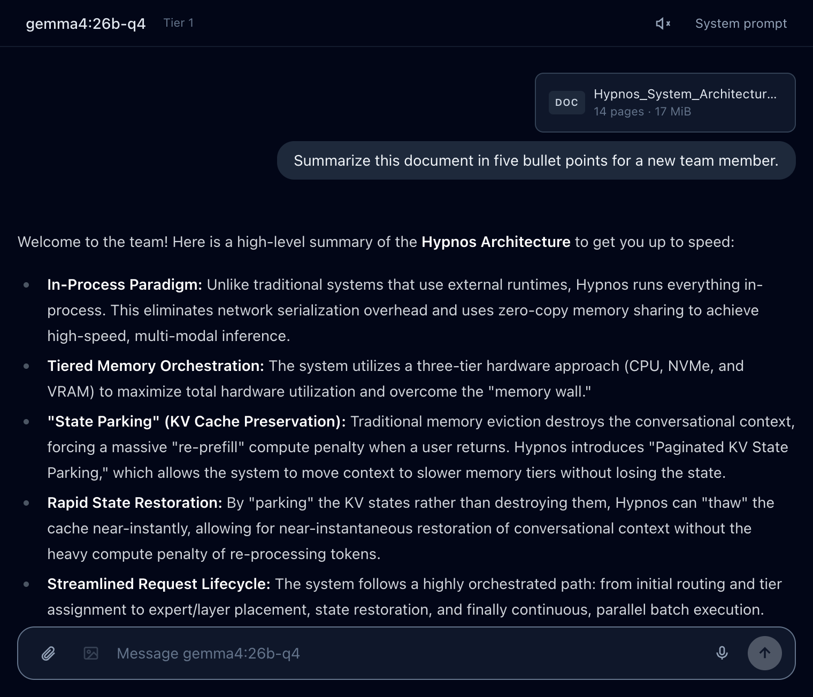

### Links

Type or paste a web address in the composer and a **Read** chip appears above it. Click it and
the app fetches the page or file (web pages, PDFs, office files, up to 50 MB) and adds its text
to your message with its title. Open the chip to copy the text, download it as a `.md` file,
or download the original file.

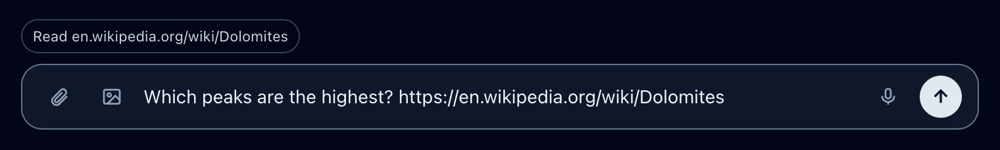

You can also just ask the chat model about a page ("what does example.com say about…"): with
tools on, it reads the page itself (section 9).

## 7. Voice: speaking and listening

### Talking to Hypnos

Click the **microphone** next to the send button to start recording and click it again (or
**Done**) to stop, or hold it down while you speak and let go. A strip shows the time and your
voice level; **Esc** or **Cancel** throws the recording away. The speech-to-text model turns
what you said into text in the composer, so you can check it before you send. Tick **send when
done** to send it straight away (the app remembers the choice). A recording stops by itself
after 5 minutes.

The first time, macOS asks to let Hypnos use the microphone. If you refused, allow it in System
Settings > Privacy & Security > Microphone.

### Hearing the answers

Click the **speaker** in the chat header to have every new answer read aloud as it arrives,
sentence by sentence; click it again to stop. **Read aloud** under an answer reads that one.
Code blocks are announced ("Code block.") instead of read, and links are read as their text.
Sending a message, switching chats or **Stop reading** stops the voice. Choose the voice and the
speed in Settings (section 11).

## 8. Images

Ask the chat model for a picture in your own words ("draw a lighthouse at dawn", "make me a
phone wallpaper of the Dolomites at night") and it asks the image model for it. The image
appears in the answer, followed by a short comment.

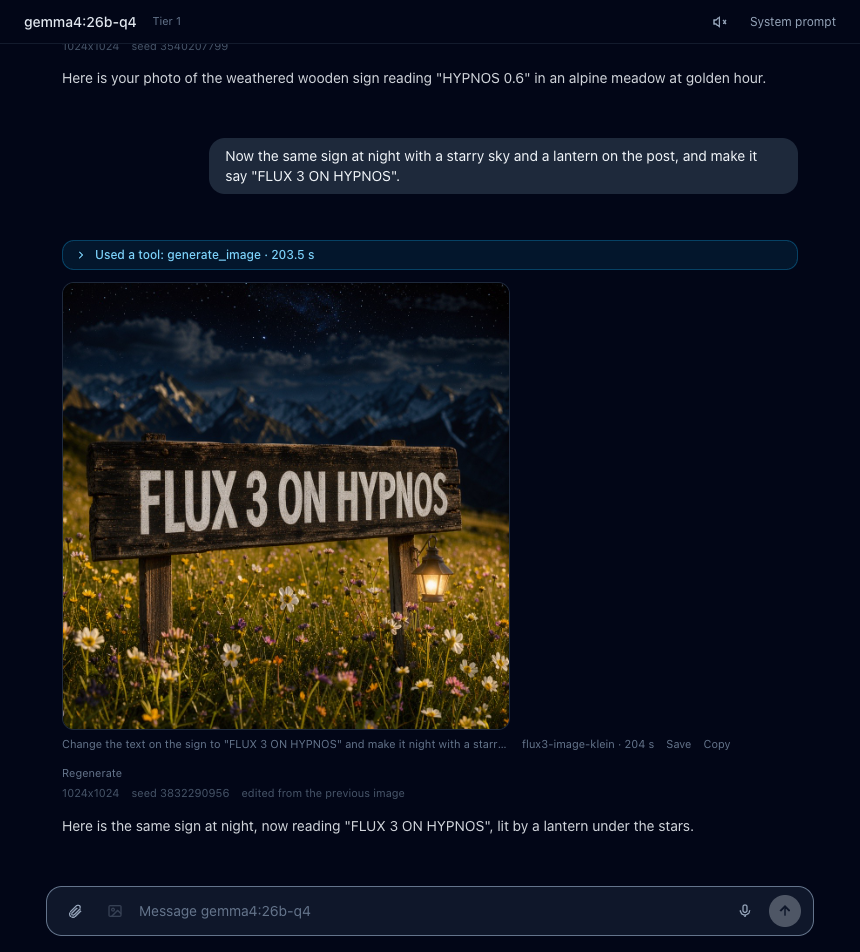

The chat model takes the details from what you write:

- **The shape**: "a phone wallpaper" becomes tall, "a banner" wide, or name the size
  ("1920x1080").
- **What to leave out**: "no text", "without people".
- **How many**: "give me three options" makes several, shown side by side.
- **Quick or detailed**: "a quick sketch" uses fewer steps, "the most detail" more.
- **Changes to an image**: "make it darker", "the same at night", "add a hat" edit the image
  made just before, or one you attached to your message. Editing needs an image model that can
  edit (FLUX.2 klein, FLUX.3); with another one you get a new image and a note saying so.
  Describe the change and what should stay ("keep the lighthouse and the framing").
- **Styles** such as black and white, watercolor, vintage film or pixel art go into the picture's
  description.

Under each image you see its description, the model and the time it took, and **Save**,
**Copy** and **Regenerate** (the same settings with a new random start, so a different take).
Below that is a line with the settings it was made with: size, seed (the random start that
makes an image reproducible), steps, what was left out, and what it was edited from. The chat
model knows these settings too, so "the same but wider" keeps the rest.

The **image button** in the composer (or typing `/image` followed by a description) sends the
text straight to the image model, without the chat model.

An image takes from tens of seconds to a few minutes, longer the first time, when the image
model has to load (which can push the chat model out of memory for a while). The answer shows
the time so far and where the model is loading from. Settings can stop the chat model from
making images (section 11).

## 9. Tools: the chat model's helpers

Besides images, the chat model can hand work to the other models:

| Tool | What it does | Done by |
| :--- | :--- | :--- |
| `fetch_url` | reads a web page or an online file you mention | the document model |
| `speak` | reads a text aloud ("say it out loud", "how do you pronounce…") | the speech model |
| `extract_entities` | lists names, organizations, places, dates or any kind of thing you ask for | the entity model |
| `describe_image` | looks at an image for a chat model that cannot see | a vision model |
| `generate_image` | makes or edits an image (section 8) | the image model |

A tool is offered only when a model that does its job is running. The chat model can use
several at once, and they run at the same time.

Tool calls show in a **blue panel** above the answer. While a tool works the panel is open and
says "Using fetch_url…"; afterwards it folds to a summary such as "Used 2 tools: fetch_url,
extract_entities · 2.8 s". Click it to see each call: what the tool was asked (**Input**), what
it gave back to the chat model (**Output**), which model did it and how long it took.

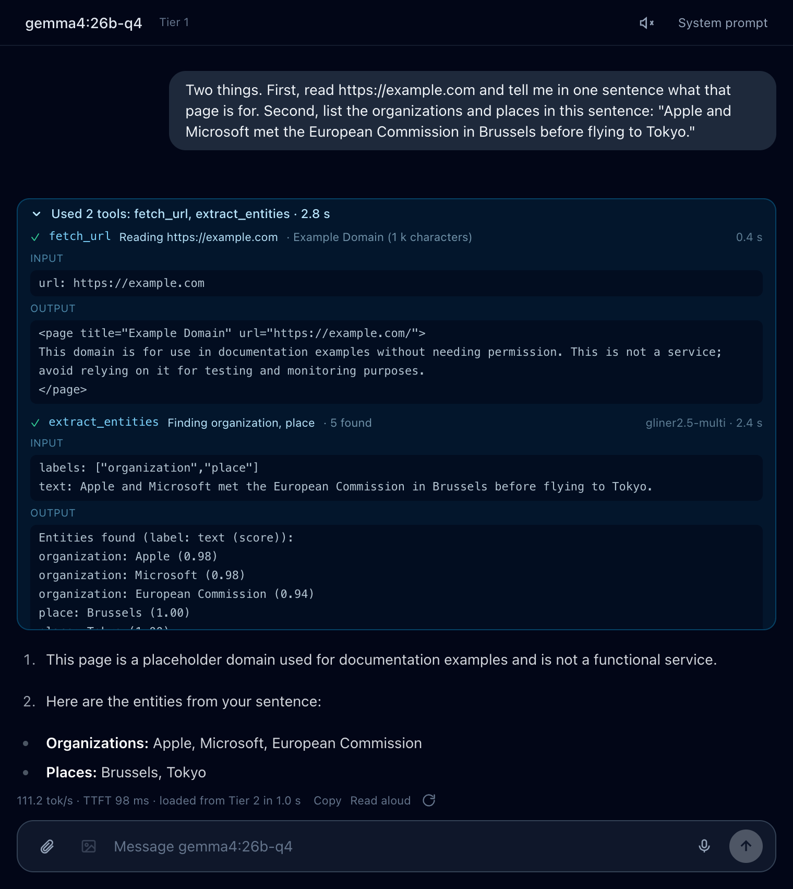

Settings can turn these tools off (section 11); the image tool has its own switch. Chat models
that do not support tool calls can still make images, but do not get the other tools.

## 10. Choosing models

Click **Models** in the header. The dialog shows the folder your models are in (with the free
space) and two tabs.

### Lineup: the models you have

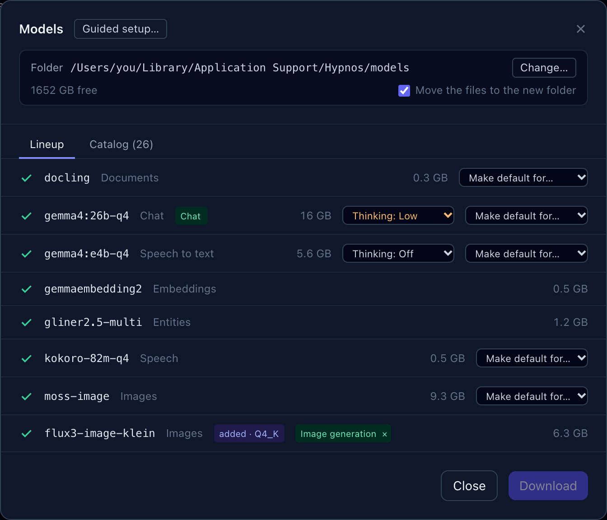

Each row is one model: a tick when its files are downloaded, its name, its main job, and its
size. For models the server is running:

- **Make default for…** chooses this model for a job it can do: **Chat** (the model every chat
  answers with), images in messages, speech to text, text to speech, image generation, or
  documents and links. The change applies to the next request; no restart.
- A green badge shows what a model is the default for ("Chat", "Image generation"); the × on
  it gives the job back to the automatic choice (the chat model when it can do the job, else a
  model that is already loaded).
- **Thinking** (on models that can think) sets how much the model reasons before it answers
  (section 5).

Models you added from the Catalog are listed last, with an **added** badge and their variant.

To download models that are missing, tick them and click **Download**. Files resume where they
stopped if you click **Stop** or lose the connection, and each file is checked when it arrives.
The app then restarts its server so the new models are used.

**Change…** moves your models to another folder (an external drive, for example); tick "Move
the files to the new folder" to take the downloaded files along.

### Catalog: models to add

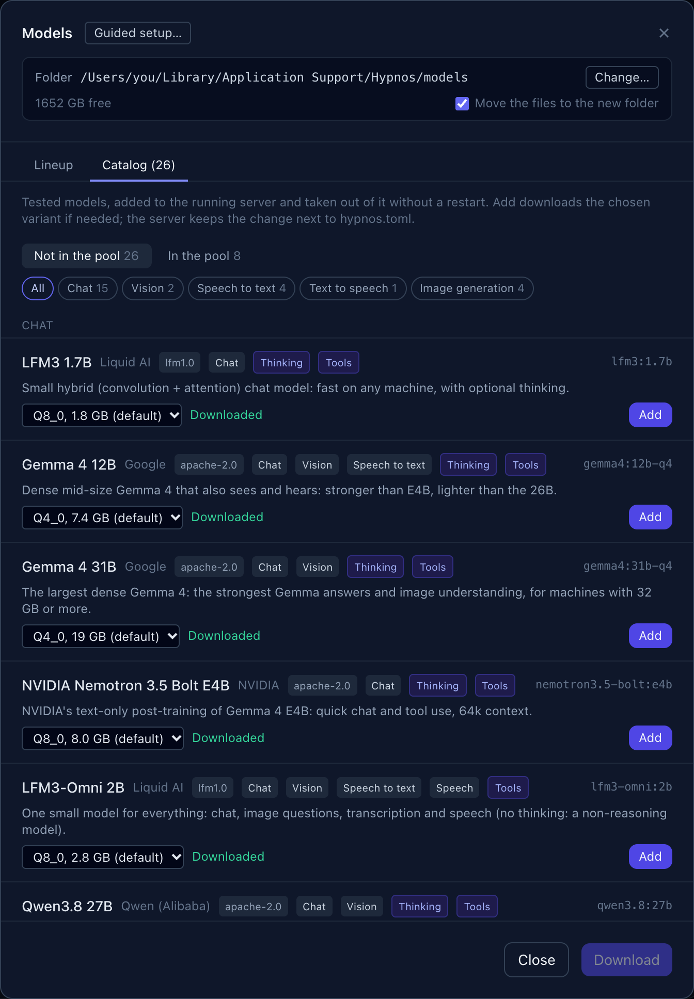

The catalog lists the models Hypnos has been tested with, in two tabs: **Not in the pool** (the
ones you can add) and **In the pool** (the ones the server has). In each, the models are grouped
by their main job: Chat, Vision, Speech to text, Text to speech, Embeddings, Image generation,
Documents, Entities. The buttons above the list (All, Chat 15, Vision 2, …) show one group alone.

Each model shows its name, maker, license, what it does (Chat, Vision, Speech to text, …),
**Thinking** and **Tools** when it supports them, and a short description. Pick a **variant** (a
smaller one is faster and uses less memory, a larger one is a little better) and click **Add**:
the app downloads it if needed and adds it to the running server, with no restart. In the
**In the pool** tab each model has **Replace** (switch to another variant) and **Remove**, and
the same Thinking and "Make default for…" menus as in the Lineup.

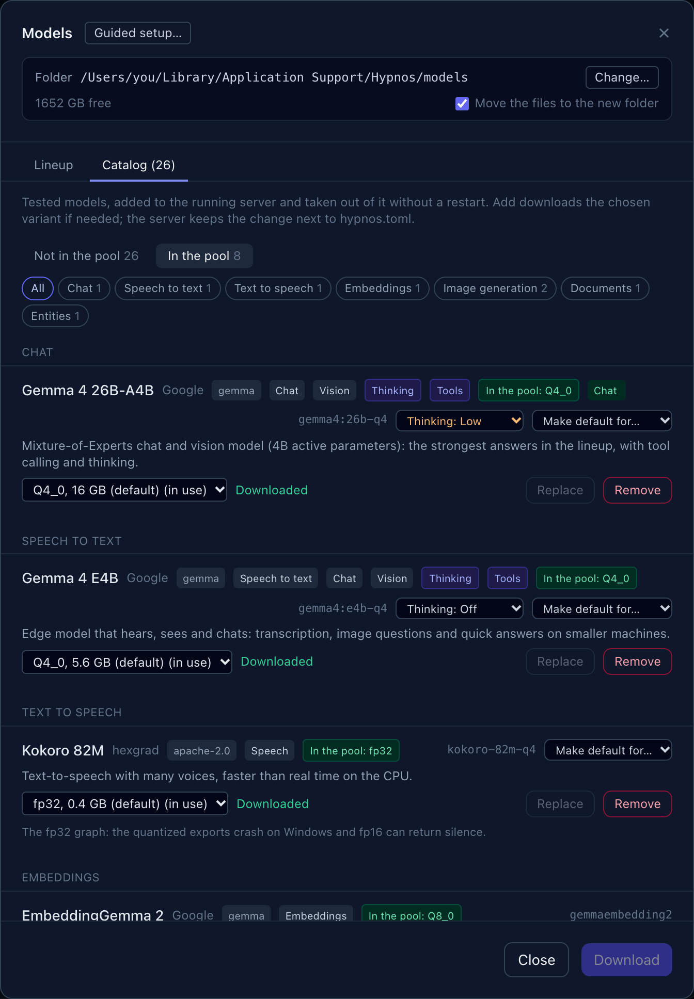

Some models come from repositories that need you to accept a license first, such as Black
Forest Labs' FLUX originals. Their variants say **needs a Hugging Face token**: accept the
license on the model's Hugging Face page, then save a read token in Settings (section 11).

**Guided setup…** at the top opens the guided setup again (section 2).

## 11. Settings

Open them by clicking the status in the header, or with Cmd/Ctrl+, (comma).

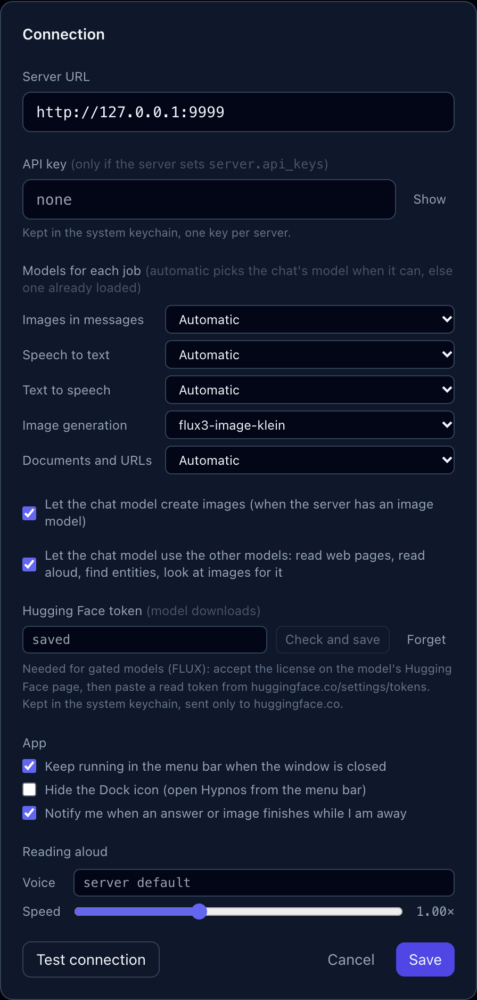

- **Server URL**: the address of the Hypnos server, such as `http://localhost:9999`.
- **API key**: only needed when the server asks for one. It is kept in your system's keychain
  (macOS Keychain, Windows Credential Manager, Secret Service on Linux), one key per server.
- **Models for each job**: the same choices as "Make default for…" in Models, for images in
  messages, speech to text, text to speech, image generation, and documents and links.
  Automatic uses the chat model when it can do the job, else a model that is already loaded.
- **Let the chat model create images**, and **Let the chat model use the other models**: the
  switches for the image tool and the other tools (section 9).
- **Hugging Face token**: for models from gated repositories. Paste a read token from
  huggingface.co/settings/tokens and click **Check and save**: the app asks Hugging Face whose
  token it is and keeps it in the keychain. It is only ever sent to huggingface.co. **Forget**
  removes it.
- **App**: keep Hypnos running in the menu bar (tray) when you close the window; hide the Dock
  icon (macOS); get a notification when an answer or image finishes while you are elsewhere.
- **Reading aloud**: the voice and the speed for answers read aloud.

**Test connection** tries the address and key before you save.

## 12. The local server

The **server button** in the header (two stacked boxes) opens the Local server dialog. It runs a
Hypnos server on this computer and connects the app to it.

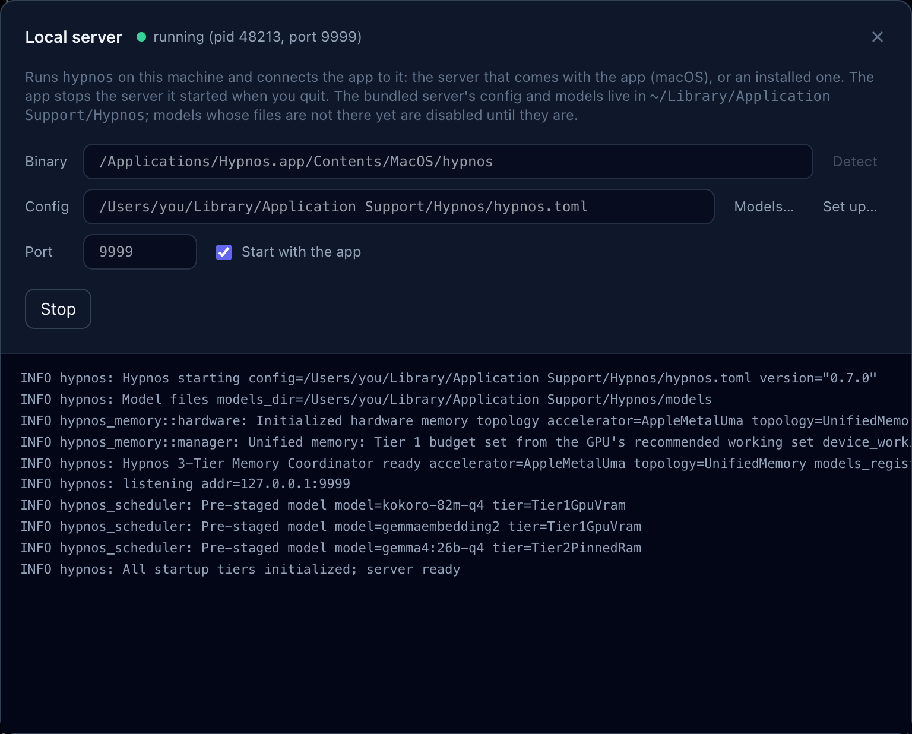

- **Binary**: the server program. On a Mac it is the one inside the app; elsewhere **Detect**
  looks for an installed `hypnos`, or enter its path.
- **Config**: the server's configuration file. The Mac app keeps its own in
  `~/Library/Application Support/Hypnos/hypnos.toml`. **Models…** and **Set up…** open the Models
  dialog and the guided setup for it.
- **Port**: where the server listens (9999 unless you change it).
- **Start with the app**: starts the server when Hypnos opens, unless one already answers on
  that port, in which case the app simply connects to it.
- **Start** / **Stop**, and below them the server's output as it runs, which helps when it does
  not start.

When you quit, the app stops the server it started; it never stops a server it did not start.
On the Mac, models whose files are missing are switched off before each start (the server would
refuse to start otherwise) and switched on again once their files are there.

## 13. The server panel

The panel on the right shows what the server is doing. It refreshes every second and a half
while it is open.

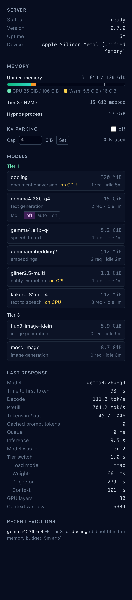

Hypnos keeps models in three places, called **tiers**:

| Tier | Where | Meaning |
| :--- | :--- | :--- |
| **Tier 1** | the graphics memory (GPU) | loaded and ready: answers start at once |
| **Tier 2** | reserved ("pinned") system memory | kept warm: moves to Tier 1 in about a second |
| **Tier 3** | the disk | not loaded: the first request loads it, which takes a few seconds |

Hypnos moves models between the tiers by itself: it loads the one you need and sets aside the
ones you have not used for a while.

- **Server**: its status, version, how long it has been running, and the device.
- **Memory**: on a Mac, one bar for the memory the graphics and the processor share (green:
  models in Tier 1, amber: models kept warm); on a PC, one bar for the graphics card and one for
  the reserved memory. Then how much is mapped from disk, and how much memory Hypnos uses in all.
- **KV parking**: when on, a conversation's working memory is kept when its model is set aside,
  so coming back to a long chat does not mean reading it all again. **Cap** limits how much
  memory it may use.
- **Models**: each model, grouped by tier, with its size, its job, "on CPU" for those that run
  on the processor, how many requests it has served and how long it has been idle. For
  Mixture-of-Experts models, **MoE** `off` / `auto` / `on` keeps part of the model in system
  memory (less graphics memory, slower answers).
- **Last response**: what the latest answer cost: the time to the first word, the speed, the
  tokens, where the model was and how long loading it took, step by step.
- **Recent evictions**: which models were set aside, for which other model, and why.

## 14. The request log

The **☰** button in the header (or Cmd/Ctrl+L) replaces the chat with the server's request log:
every request with its time, route, model, status, duration, tokens, speed and tier.

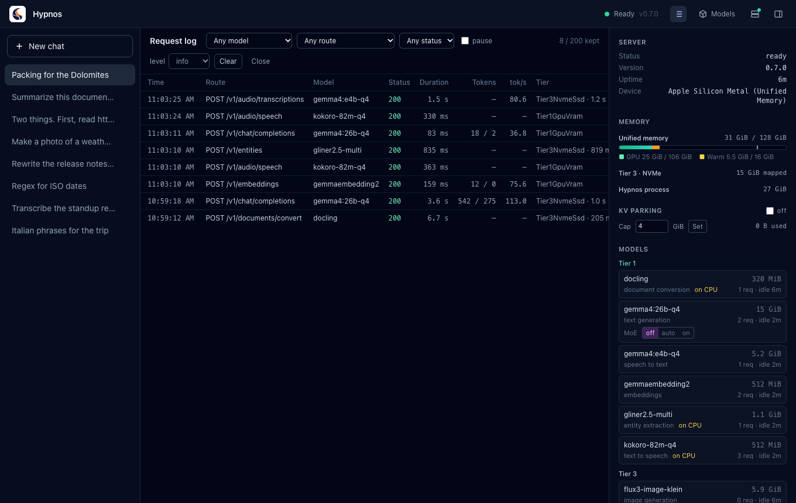

Filter by model, route or status; **pause** stops the refresh. Click a row to see the whole
record, and **Copy JSON** to copy it.

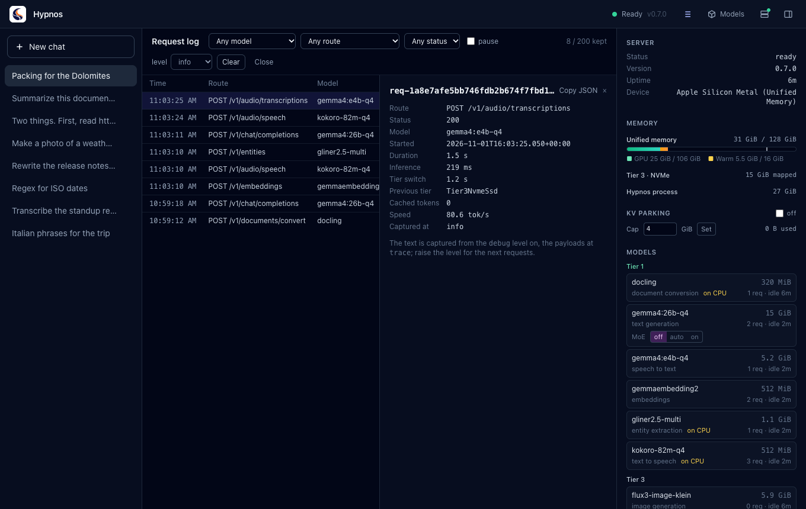

The **level** menu sets what the server records from now on: `info` keeps the numbers;
`debug` also keeps the text that went in and came out; `trace` keeps the full requests.
**Clear** empties the log for everyone using this server. **Log** under an answer opens that
answer's record directly.

## 15. The menu bar and notifications

Hypnos puts its logo in the menu bar (macOS) or the system tray (Windows, Linux), with a dot for
the server's state: green ready, amber loading, red unreachable or key refused, grey connecting.
Click it to show or hide the window. Its menu has:

- the status and version, and **Open Hypnos**;
- **Stop the server** / **Start the server**, for a server running on this computer (also one
  you started yourself);
- **Connection settings…** and **Quit**.

Closing the window keeps Hypnos running in the menu bar, unless you turned that off in
Settings. When an answer or an image finishes while the window is hidden or in the background,
a notification tells you.

## 16. Keyboard shortcuts

On Windows and Linux use Ctrl where the Mac uses Cmd.

| Shortcut | Action |
| :--- | :--- |
| Enter | send the message |
| Shift+Enter | new line in the message |
| Esc | cancel a recording |
| Cmd+N | new chat |
| Cmd+. | show or hide the server panel |
| Cmd+, | settings |
| Cmd+L | request log |

## 17. Troubleshooting

**The status says Unreachable.** The server is not running or the address is wrong. On a Mac,
open the Local server dialog and click **Start**; its output shows why it stops, if it does.
Otherwise check the address in Settings and that the server is running.

**API key refused.** The server asks for a key. Enter it in Settings; it is saved per server.

**Warming up for a long time.** The server is loading its first models; large models take
longer the first time after a restart. The server panel shows them arriving in Tier 1.

**The first answer of the day is slow.** Its model was on disk (Tier 3) and had to load: the
line under the answer says "loaded from Tier 3 in …". Later answers are fast.

**"Not enough memory to load this model right now."** Other models are busy and cannot be set
aside. Wait for them to finish, or use smaller models (the guided setup and the catalog's
variants help with that).

**An image takes minutes.** Image models are large, and loading one can push the chat model
out of memory; the answer shows where the model is loading from. Smaller image models (FLUX.2
klein, Iris) and fewer steps ("a quick sketch") are faster.

**The microphone does nothing.** Allow Hypnos in System Settings > Privacy & Security >
Microphone (macOS), and check that a speech-to-text model is in the lineup.

**A download says the repository is gated.** Accept the model's license on its Hugging Face page
with your account, then save a read token in Settings.

**The app cannot read a file.** Very large files, or formats the document model does not know,
are refused with a message on the chip. Documents over about 60,000 characters are cut, and
the chip says so.

**Something else.** Open the request log, find the request (status 4xx or 5xx), open it and
use **Copy JSON**: the record says what went wrong. Its id (`req-…`) identifies it in the
server's own log.

## 18. Where your data is kept

| What | Where |
| :--- | :--- |
| Chats, the server address, your model choices | the app's data folder: `~/Library/Application Support/dev.hypnos.desktop/` (macOS), `%APPDATA%\dev.hypnos.desktop\` (Windows), `~/.local/share/dev.hypnos.desktop/` (Linux) |
| API keys, the Hugging Face token | the system keychain |
| The Mac server's configuration and models | `~/Library/Application Support/Hypnos/` (`hypnos.toml`, `models/`), unless you moved the models |
| What the server records about requests | the server's memory only (the request log), until it restarts or is cleared |

Your chats never leave your computer except as requests to the Hypnos server you connected to.
To start over, delete the chats in the sidebar. On a Mac you can also delete `hypnos.toml` in
the Hypnos folder above: the app writes a fresh one from its template at the next start.
